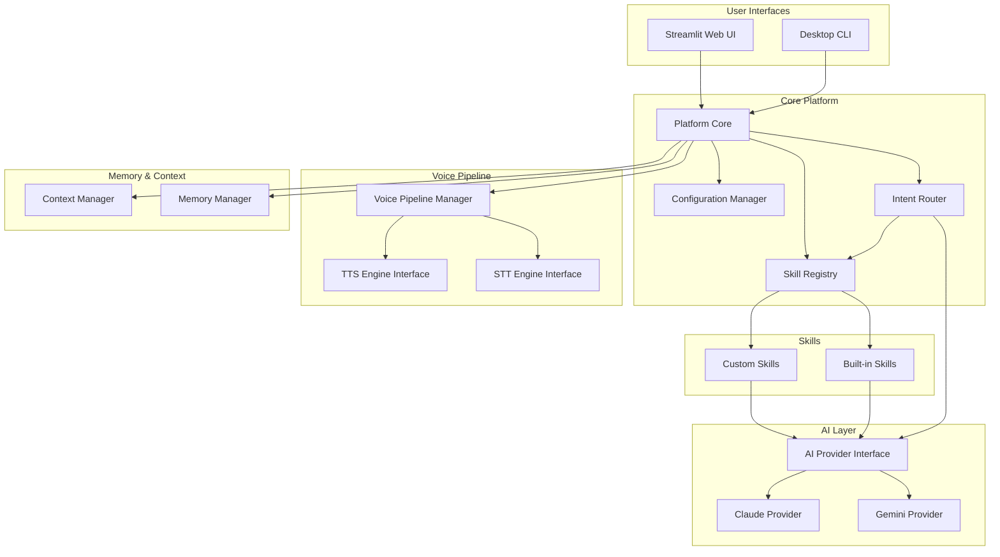
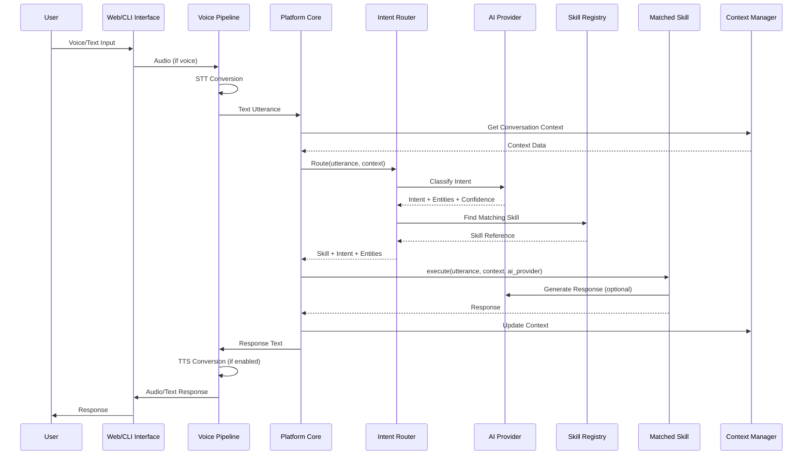

# Design Document: Meryna Voice Platform

## Overview

This document outlines the technical design for restructuring the Meryna voice assistant into a scalable, extensible platform inspired by Amazon Alexa. The redesigned architecture transforms the current monolithic implementation into a modular, plugin-based system with clear separation of concerns.

### Goals

1. **Extensibility**: Enable adding new voice command capabilities without modifying core platform code
2. **Modularity**: Support swappable STT/TTS engines and AI providers
3. **Consistency**: Unified AI provider interface across all components
4. **Multi-Interface**: Support both web (Streamlit) and CLI interfaces with shared infrastructure
5. **Reliability**: Graceful error handling and degradation

### Current State

The existing implementation consists of:
- `app.py`: Streamlit web interface with hardcoded JARVIS theme
- `Meryna.py`: CLI application with Gemini integration and tightly coupled voice handling
- `meryna_brain.py`: Anthropic Claude integration with web search tools
- `meryna_voice.py`: TTS and STT utilities for both web and desktop

### Target State

A plugin-based platform with:
- Core platform orchestrating skills, AI, and voice pipeline
- Skill registry with hot-reload capabilities
- Intent router using AI for natural language understanding
- Modular voice pipeline with swappable engines
- Unified configuration management
- Shared infrastructure for web and CLI interfaces


## Architecture

### High-Level Architecture Diagram




### Request Flow




## Components and Interfaces

### 1. Platform Core

The central orchestrator that initializes and coordinates all platform components.

```python
class Platform:
    """Core platform orchestrator."""
    
    def __init__(self, config_path: Optional[Path] = None):
        """Initialize platform with configuration."""
        pass
    
    async def start(self) -> None:
        """Start the platform and all components."""
        pass
    
    async def shutdown(self) -> None:
        """Gracefully shutdown platform and all skills."""
        pass
    
    async def process_utterance(
        self, 
        utterance: str, 
        session_id: str
    ) -> PlatformResponse:
        """Process a user utterance and return response."""
        pass
    
    def get_skill_registry(self) -> SkillRegistry:
        """Get the skill registry instance."""
        pass
    
    def get_ai_provider(self) -> AIProvider:
        """Get the AI provider instance."""
        pass
    
    def get_voice_pipeline(self) -> VoicePipeline:
        """Get the voice pipeline instance."""
        pass

@dataclass
class PlatformResponse:
    """Response from platform processing."""
    text: str
    skill_name: Optional[str]
    confidence: float
    metadata: Dict[str, Any]
    error: Optional[str] = None
```


### 2. Skill Registry

Manages skill discovery, loading, validation, and lifecycle.

```python
class SkillRegistry:
    """Discovers, validates, and manages skills."""
    
    def __init__(
        self, 
        skills_dir: Path, 
        config_manager: ConfigurationManager
    ):
        """Initialize registry with skills directory."""
        pass
    
    async def discover_skills(self) -> List[str]:
        """Discover all skills in the skills directory."""
        pass
    
    async def load_skill(self, skill_name: str) -> bool:
        """Load and validate a skill. Returns success status."""
        pass
    
    async def unload_skill(self, skill_name: str) -> bool:
        """Unload a skill and call cleanup lifecycle."""
        pass
    
    def get_skill(self, skill_name: str) -> Optional[Skill]:
        """Get a loaded skill by name."""
        pass
    
    def get_enabled_skills(self) -> List[Skill]:
        """Get all enabled skills."""
        pass
    
    def get_all_intents(self) -> List[IntentPattern]:
        """Get intent patterns from all enabled skills."""
        pass
    
    async def enable_skill(self, skill_name: str) -> bool:
        """Enable a skill and call on_enable lifecycle."""
        pass
    
    async def disable_skill(self, skill_name: str) -> bool:
        """Disable a skill and call on_disable lifecycle."""
        pass

@dataclass
class IntentPattern:
    """Pattern for matching user intents to skills."""
    skill_name: str
    intent_name: str
    description: str
    example_utterances: List[str]
```


### 3. Base Skill Class

Abstract base class that all skills must extend.

```python
from abc import ABC, abstractmethod
from typing import Any, Dict, List, Optional
from dataclasses import dataclass

@dataclass
class SkillContext:
    """Context passed to skill execution."""
    utterance: str
    intent_name: str
    entities: Dict[str, Any]
    conversation_history: List[Dict[str, str]]
    user_preferences: Dict[str, Any]
    session_id: str

@dataclass
class SkillResponse:
    """Response from skill execution."""
    text: str
    should_end_session: bool = False
    follow_up_prompt: Optional[str] = None
    metadata: Dict[str, Any] = None

class Skill(ABC):
    """Base class for all Meryna skills."""
    
    def __init__(self, ai_provider: 'AIProvider'):
        """Initialize skill with AI provider access."""
        self._ai_provider = ai_provider
    
    @property
    @abstractmethod
    def name(self) -> str:
        """Skill identifier from manifest."""
        pass
    
    @property
    @abstractmethod
    def version(self) -> str:
        """Skill version from manifest."""
        pass
    
    @abstractmethod
    async def execute(self, context: SkillContext) -> SkillResponse:
        """Execute the skill with given context."""
        pass
    
    # Lifecycle hooks with default no-op implementations
    async def on_load(self) -> None:
        """Called when skill is loaded. Override for initialization."""
        pass
    
    async def on_enable(self) -> None:
        """Called when skill is enabled. Override for setup."""
        pass
    
    async def on_disable(self) -> None:
        """Called when skill is disabled. Override for cleanup."""
        pass
    
    async def on_unload(self) -> None:
        """Called when skill is unloaded. Override for final cleanup."""
        pass
```


### 4. Intent Router

Routes user utterances to appropriate skills using AI-powered intent classification.

```python
@dataclass
class RoutingResult:
    """Result of intent routing."""
    skill: Optional[Skill]
    intent_name: str
    confidence: float
    entities: Dict[str, Any]
    fallback_used: bool = False

class IntentRouter:
    """Routes utterances to skills using AI intent classification."""
    
    def __init__(
        self, 
        ai_provider: AIProvider, 
        skill_registry: SkillRegistry,
        fallback_skill_name: str = "conversation"
    ):
        """Initialize router with AI and skill registry."""
        pass
    
    async def route(
        self, 
        utterance: str, 
        context: Optional[Dict[str, Any]] = None
    ) -> RoutingResult:
        """
        Route an utterance to the appropriate skill.
        
        Uses AI for intent classification with keyword fallback
        if AI is unavailable or times out.
        """
        pass
    
    async def _classify_intent_with_ai(
        self, 
        utterance: str,
        available_intents: List[IntentPattern]
    ) -> Tuple[str, float, Dict[str, Any]]:
        """Use AI to classify intent and extract entities."""
        pass
    
    def _classify_intent_with_keywords(
        self, 
        utterance: str,
        available_intents: List[IntentPattern]
    ) -> Tuple[str, float]:
        """Fallback keyword-based intent matching."""
        pass
    
    def _select_skill(
        self, 
        intent_name: str, 
        confidence: float,
        candidates: List[Tuple[Skill, float]]
    ) -> Optional[Skill]:
        """Select skill from candidates by confidence and registration order."""
        pass
```


### 5. AI Provider Interface

Unified interface for AI backends with support for multiple providers.

```python
from abc import ABC, abstractmethod
from enum import Enum
from typing import List, Optional

class AIProviderType(Enum):
    GEMINI = "gemini"
    CLAUDE = "claude"

@dataclass
class IntentClassification:
    """Result of intent classification."""
    intent_name: str
    confidence: float  # 0.0 to 1.0
    raw_response: str

@dataclass
class EntityExtraction:
    """Extracted entities from text."""
    entities: Dict[str, Any]  # e.g., {"location": "Bengaluru", "date": "tomorrow"}

class AIProvider(ABC):
    """Abstract base class for AI providers."""
    
    @abstractmethod
    async def generate_text(
        self, 
        prompt: str,
        conversation_history: Optional[List[Dict[str, str]]] = None,
        system_prompt: Optional[str] = None,
        max_tokens: int = 1024
    ) -> str:
        """Generate text response from prompt."""
        pass
    
    @abstractmethod
    async def classify_intent(
        self, 
        user_input: str,
        available_intents: List[IntentPattern]
    ) -> IntentClassification:
        """Classify user input into an intent."""
        pass
    
    @abstractmethod
    async def extract_entities(
        self, 
        text: str,
        entity_types: Optional[List[str]] = None
    ) -> EntityExtraction:
        """Extract named entities from text."""
        pass
    
    @abstractmethod
    async def initialize(self) -> bool:
        """Initialize the provider. Returns success status."""
        pass
    
    @abstractmethod
    async def health_check(self) -> bool:
        """Check if provider is healthy and responsive."""
        pass
```


```python
class AIProviderManager:
    """Manages AI providers with fallback support."""
    
    def __init__(
        self, 
        config_manager: ConfigurationManager,
        personality_prompt: str
    ):
        """Initialize with configuration and personality."""
        self._primary: Optional[AIProvider] = None
        self._fallback: Optional[AIProvider] = None
        self._personality_prompt = personality_prompt
        self._max_history = 20
    
    async def initialize(self, timeout_seconds: int = 30) -> bool:
        """Initialize primary (and optionally fallback) provider."""
        pass
    
    def get_provider(self) -> AIProvider:
        """Get the active AI provider (primary or fallback)."""
        pass
    
    async def generate_text(
        self, 
        prompt: str,
        conversation_history: Optional[List[Dict[str, str]]] = None
    ) -> str:
        """Generate text with automatic fallback on failure."""
        pass
    
    async def classify_intent(
        self, 
        user_input: str,
        available_intents: List[IntentPattern]
    ) -> IntentClassification:
        """Classify intent with automatic fallback."""
        pass

class GeminiProvider(AIProvider):
    """Google Gemini AI provider implementation."""
    
    def __init__(self, api_key: str, model: str = "gemini-2.5-flash"):
        pass

class ClaudeProvider(AIProvider):
    """Anthropic Claude AI provider implementation."""
    
    def __init__(self, api_key: str, model: str = "claude-sonnet-4-5"):
        pass
```


### 6. Voice Pipeline

Modular voice processing with swappable STT and TTS engines.

```python
from abc import ABC, abstractmethod
from enum import Enum

class STTEngineType(Enum):
    GOOGLE = "google"
    WHISPER = "whisper"
    WEB_SPEECH = "web_speech"

class TTSEngineType(Enum):
    EDGE_TTS = "edge_tts"
    PYTTSX3 = "pyttsx3"
    BROWSER = "browser"

@dataclass
class VoiceConfig:
    """Voice configuration settings."""
    gender: str = "female"  # "male" or "female"
    language: str = "en-IN"
    speech_rate: int = 165  # 50-300 wpm
    volume: float = 0.9  # 0.0-1.0
    voice_id: Optional[str] = None

class STTEngine(ABC):
    """Abstract base for speech-to-text engines."""
    
    @abstractmethod
    async def transcribe(
        self, 
        timeout: int = 5,
        max_duration: int = 15
    ) -> Optional[str]:
        """Convert speech to text. Returns None on failure."""
        pass
    
    @abstractmethod
    def is_available(self) -> bool:
        """Check if engine is available for use."""
        pass

class TTSEngine(ABC):
    """Abstract base for text-to-speech engines."""
    
    @abstractmethod
    async def speak(self, text: str, block: bool = True) -> bool:
        """Convert text to speech. Returns success status."""
        pass
    
    @abstractmethod
    def stop(self) -> None:
        """Stop current speech playback."""
        pass
    
    @abstractmethod
    def is_available(self) -> bool:
        """Check if engine is available for use."""
        pass
    
    @abstractmethod
    def configure(self, config: VoiceConfig) -> None:
        """Apply voice configuration."""
        pass
```


```python
class VoicePipeline:
    """Manages voice input/output with swappable engines."""
    
    def __init__(self, config_manager: ConfigurationManager):
        """Initialize pipeline with configuration."""
        self._stt_engine: Optional[STTEngine] = None
        self._tts_engine: Optional[TTSEngine] = None
        self._voice_enabled: bool = True
        self._fallback_to_text: bool = True
    
    async def initialize(self) -> bool:
        """Initialize configured STT and TTS engines."""
        pass
    
    def set_stt_engine(self, engine_type: STTEngineType) -> bool:
        """Switch STT engine without restart."""
        pass
    
    def set_tts_engine(self, engine_type: TTSEngineType) -> bool:
        """Switch TTS engine without restart."""
        pass
    
    async def listen(self) -> Optional[str]:
        """
        Listen for voice input.
        Falls back to None with notification on failure.
        """
        pass
    
    async def speak(self, text: str) -> bool:
        """
        Speak text using TTS engine.
        Falls back to text-only mode on failure.
        """
        pass
    
    def configure_voice(self, config: VoiceConfig) -> None:
        """Apply voice configuration to TTS engine."""
        pass
    
    def enable_voice(self, enabled: bool) -> None:
        """Enable or disable voice output."""
        pass

# Concrete implementations
class GoogleSTTEngine(STTEngine):
    """Google Speech Recognition STT engine."""
    pass

class WhisperSTTEngine(STTEngine):
    """OpenAI Whisper STT engine."""
    pass

class WebSpeechSTTEngine(STTEngine):
    """Browser Web Speech API STT engine."""
    pass

class EdgeTTSEngine(TTSEngine):
    """Microsoft Edge TTS engine (neural voices)."""
    pass

class Pyttsx3TTSEngine(TTSEngine):
    """pyttsx3 TTS engine (offline capable)."""
    pass

class BrowserTTSEngine(TTSEngine):
    """Browser Web Speech API TTS engine."""
    pass
```


### 7. Configuration Manager

Centralized configuration management with validation and hot-reload.

```python
from pathlib import Path
from typing import Any, Dict, Optional, Callable

@dataclass
class SkillConfig:
    """Configuration for a single skill."""
    name: str
    enabled: bool
    settings: Dict[str, Any]

class ConfigurationManager:
    """Manages platform and skill configuration."""
    
    CONFIG_FILE = "meryna_config.json"
    
    def __init__(self, config_dir: Optional[Path] = None):
        """Initialize with config directory (default: user home)."""
        self._config: Dict[str, Any] = {}
        self._skill_configs: Dict[str, SkillConfig] = {}
        self._change_listeners: List[Callable] = []
    
    def load(self) -> bool:
        """
        Load configuration from file.
        Creates default config if file missing or unreadable.
        """
        pass
    
    def save(self) -> bool:
        """Save current configuration to file."""
        pass
    
    def get(self, key: str, default: Any = None) -> Any:
        """Get a configuration value."""
        pass
    
    def set(self, key: str, value: Any) -> bool:
        """
        Set a configuration value with validation.
        Notifies listeners on success.
        """
        pass
    
    def get_skill_config(self, skill_name: str) -> Optional[SkillConfig]:
        """Get configuration for a specific skill."""
        pass
    
    def set_skill_enabled(self, skill_name: str, enabled: bool) -> bool:
        """Enable or disable a skill."""
        pass
    
    def set_skill_setting(
        self, 
        skill_name: str, 
        key: str, 
        value: Any,
        schema: Optional[Dict] = None
    ) -> bool:
        """
        Set a skill-specific setting.
        Validates against schema if provided.
        """
        pass
    
    def register_skill_defaults(
        self, 
        skill_name: str, 
        default_enabled: bool,
        default_settings: Dict[str, Any]
    ) -> None:
        """Register default configuration for a new skill."""
        pass
    
    def on_change(self, callback: Callable[[str, Any], None]) -> None:
        """Register a callback for configuration changes."""
        pass
```


### 8. Memory and Context Management

```python
from pathlib import Path
from typing import Any, Dict, List, Optional
from dataclasses import dataclass, field

@dataclass
class UserPreferences:
    """User preference storage."""
    name: str = "Friend"  # max 50 chars
    location: str = ""  # max 100 chars (city, region)
    voice_id: Optional[str] = None
    speech_rate: int = 165  # 50-300
    volume: float = 0.9  # 0.0-1.0

@dataclass 
class ConversationTurn:
    """Single conversation turn."""
    role: str  # "user" or "assistant"
    content: str
    timestamp: float
    skill_name: Optional[str] = None

class MemoryManager:
    """Persists conversation history and user preferences."""
    
    MEMORY_FILE = ".meryna_memory.json"
    DEFAULT_HISTORY_LIMIT = 30
    
    def __init__(
        self, 
        storage_path: Optional[Path] = None,
        history_limit: int = DEFAULT_HISTORY_LIMIT
    ):
        """Initialize with storage path (default: user home)."""
        self._storage_path = storage_path or Path.home() / self.MEMORY_FILE
        self._history_limit = history_limit
        self._history: List[ConversationTurn] = []
        self._preferences: UserPreferences = UserPreferences()
        self._in_memory_only: bool = False
    
    def load(self) -> bool:
        """
        Load history and preferences from storage.
        Uses in-memory mode if storage unavailable.
        Discards corrupted data and starts fresh.
        """
        pass
    
    def save(self) -> bool:
        """
        Save to storage. Retries on next save if fails.
        """
        pass
    
    def add_turn(
        self, 
        role: str, 
        content: str, 
        skill_name: Optional[str] = None
    ) -> None:
        """Add a conversation turn."""
        pass
    
    def get_history(self, limit: Optional[int] = None) -> List[ConversationTurn]:
        """Get conversation history up to limit."""
        pass
    
    def get_preferences(self) -> UserPreferences:
        """Get user preferences."""
        pass
    
    def set_preferences(self, preferences: UserPreferences) -> bool:
        """Update user preferences with validation."""
        pass
    
    def clear_history(self) -> None:
        """Clear conversation history."""
        pass
```


```python
@dataclass
class ConversationState:
    """Current conversation state."""
    active_skill: Optional[str] = None
    follow_up_queue: List[str] = field(default_factory=list)  # max 5
    session_data: Dict[str, Any] = field(default_factory=dict)

class ContextManager:
    """Maintains conversation state and provides context to skills."""
    
    MAX_FOLLOW_UPS = 5
    CONTEXT_TURNS = 10
    
    def __init__(self, memory_manager: MemoryManager):
        """Initialize with memory manager."""
        self._memory = memory_manager
        self._state = ConversationState()
    
    def get_skill_context(self, session_id: str) -> Dict[str, Any]:
        """
        Get context for skill execution.
        Returns last 10 turns and all preferences.
        """
        pass
    
    def set_active_skill(self, skill_name: Optional[str]) -> None:
        """Set the currently active skill."""
        pass
    
    def get_active_skill(self) -> Optional[str]:
        """Get the currently active skill."""
        pass
    
    def add_follow_up(self, prompt: str) -> bool:
        """Add a follow-up prompt to the queue (max 5)."""
        pass
    
    def pop_follow_up(self) -> Optional[str]:
        """Get and remove next follow-up prompt."""
        pass
    
    def clear_state(self) -> None:
        """Clear conversation state (not history)."""
        pass
    
    def set_session_data(self, key: str, value: Any) -> None:
        """Store session-scoped data."""
        pass
    
    def get_session_data(self, key: str) -> Optional[Any]:
        """Retrieve session-scoped data."""
        pass
```


### 9. Logging and Diagnostics

```python
import logging
from pathlib import Path
from typing import Optional

class PlatformLogger:
    """Centralized logging with skill prefixing and rotation."""
    
    LOG_FILE = "meryna.log"
    MAX_FILE_SIZE = 10 * 1024 * 1024  # 10 MB
    BACKUP_COUNT = 5
    DEFAULT_LEVEL = logging.INFO
    
    def __init__(
        self, 
        log_dir: Optional[Path] = None,
        level: int = DEFAULT_LEVEL
    ):
        """Initialize logger with directory and level."""
        pass
    
    def set_level(self, level: int) -> None:
        """Set log level (DEBUG, INFO, WARNING, ERROR)."""
        pass
    
    def log_skill_invocation(
        self, 
        skill_name: str, 
        utterance: str,
        response_time_ms: float
    ) -> None:
        """Log skill invocation with timing."""
        pass
    
    def log_ai_request(
        self, 
        operation: str,
        request_payload: Dict[str, Any],
        response_payload: Dict[str, Any]
    ) -> None:
        """Log AI provider request/response at DEBUG level."""
        pass
    
    def log_error(
        self, 
        message: str, 
        exception: Optional[Exception] = None,
        skill_name: Optional[str] = None
    ) -> None:
        """Log error with optional stack trace."""
        pass
    
    def skill_logger(self, skill_name: str) -> logging.Logger:
        """Get a logger instance prefixed with skill name."""
        pass
```


### 10. Error Handling

```python
from dataclasses import dataclass
from enum import Enum
from typing import Optional
import asyncio
import time

class ErrorCategory(Enum):
    SKILL_ERROR = "skill_error"
    AI_RATE_LIMIT = "ai_rate_limit"
    AI_AUTH_ERROR = "ai_auth_error"
    NETWORK_ERROR = "network_error"
    CONFIG_ERROR = "config_error"
    VOICE_ERROR = "voice_error"

@dataclass
class PlatformError:
    """User-safe error representation."""
    category: ErrorCategory
    user_message: str  # Safe message for user
    internal_message: str  # Full details for logging
    service_name: Optional[str] = None
    retryable: bool = False

class ErrorHandler:
    """Centralized error handling with retry and circuit breaker."""
    
    MAX_RETRIES = 3
    INITIAL_DELAY = 1.0
    MAX_DELAY = 30.0
    CIRCUIT_BREAKER_THRESHOLD = 3
    CIRCUIT_BREAKER_WINDOW = 300  # 5 minutes
    CIRCUIT_BREAKER_TIMEOUT = 300  # 5 minutes disabled
    
    def __init__(self, logger: PlatformLogger):
        """Initialize with platform logger."""
        self._logger = logger
        self._skill_errors: Dict[str, List[float]] = {}  # skill -> error timestamps
        self._disabled_skills: Dict[str, float] = {}  # skill -> disable time
    
    def handle_skill_error(
        self, 
        skill_name: str, 
        exception: Exception
    ) -> PlatformError:
        """
        Handle skill execution error.
        Tracks consecutive errors and disables skill if threshold exceeded.
        """
        pass
    
    def handle_ai_error(self, exception: Exception) -> PlatformError:
        """Handle AI provider error with appropriate user message."""
        pass
    
    def is_skill_disabled(self, skill_name: str) -> bool:
        """Check if skill is temporarily disabled due to errors."""
        pass
    
    def reset_skill_errors(self, skill_name: str) -> None:
        """Reset error count for a skill (called on successful execution)."""
        pass
    
    async def with_retry(
        self, 
        operation: Callable,
        is_retryable: Callable[[Exception], bool]
    ) -> Any:
        """
        Execute operation with exponential backoff retry.
        Retries on network timeouts, connection resets, HTTP 5xx.
        """
        pass
    
    @staticmethod
    def to_user_message(error: PlatformError) -> str:
        """Convert error to user-friendly message without technical details."""
        pass
```


## Data Models

### Skill Manifest Schema

```json
{
  "$schema": "http://json-schema.org/draft-07/schema#",
  "title": "Skill Manifest",
  "type": "object",
  "required": ["name", "version", "description", "entry_point", "intents"],
  "properties": {
    "name": {
      "type": "string",
      "pattern": "^[a-zA-Z0-9_-]{1,64}$",
      "description": "Unique skill identifier"
    },
    "version": {
      "type": "string",
      "pattern": "^\\d+\\.\\d+\\.\\d+$",
      "description": "Semantic version (MAJOR.MINOR.PATCH)"
    },
    "description": {
      "type": "string",
      "minLength": 1,
      "maxLength": 500,
      "description": "Human-readable skill description"
    },
    "entry_point": {
      "type": "string",
      "pattern": "^[a-zA-Z_][a-zA-Z0-9_.]*:[A-Z][a-zA-Z0-9_]*$",
      "description": "Python module:ClassName format"
    },
    "intents": {
      "type": "array",
      "minItems": 1,
      "items": {
        "type": "object",
        "required": ["intent_name", "description", "example_utterances"],
        "properties": {
          "intent_name": {
            "type": "string",
            "description": "Unique intent identifier within skill"
          },
          "description": {
            "type": "string",
            "description": "What this intent does"
          },
          "example_utterances": {
            "type": "array",
            "minItems": 3,
            "items": {"type": "string"},
            "description": "Example phrases that trigger this intent"
          }
        }
      }
    },
    "permissions": {
      "type": "array",
      "items": {
        "type": "string",
        "enum": ["file_system", "network", "user_data", "audio_input", "audio_output", "system_settings"]
      },
      "description": "Required permissions"
    },
    "configuration_schema": {
      "type": "object",
      "description": "JSON Schema for skill-specific configuration"
    },
    "dependencies": {
      "type": "array",
      "items": {"type": "string"},
      "description": "Required Python packages"
    },
    "default_enabled": {
      "type": "boolean",
      "default": true,
      "description": "Whether skill is enabled by default"
    }
  }
}
```


### Example Skill Manifest

```json
{
  "name": "weather-skill",
  "version": "1.0.0",
  "description": "Provides current weather conditions and forecasts for any location",
  "entry_point": "weather:WeatherSkill",
  "intents": [
    {
      "intent_name": "get_weather",
      "description": "Get current weather for a location",
      "example_utterances": [
        "What's the weather in Bengaluru",
        "How's the weather today",
        "Is it going to rain",
        "Temperature in Mumbai",
        "Weather forecast for Chennai"
      ]
    }
  ],
  "permissions": ["network"],
  "configuration_schema": {
    "type": "object",
    "properties": {
      "default_location": {
        "type": "string",
        "default": "Bengaluru"
      },
      "units": {
        "type": "string",
        "enum": ["celsius", "fahrenheit"],
        "default": "celsius"
      }
    }
  },
  "default_enabled": true
}
```

### Platform Configuration Schema

```json
{
  "ai_provider": {
    "primary": {
      "type": "claude",
      "model": "claude-sonnet-4-5",
      "api_key_env": "ANTHROPIC_API_KEY"
    },
    "fallback": {
      "type": "gemini",
      "model": "gemini-2.5-flash",
      "api_key_env": "GEMINI_API_KEY"
    }
  },
  "voice_pipeline": {
    "stt_engine": "google",
    "tts_engine": "edge_tts",
    "voice_config": {
      "gender": "female",
      "language": "en-IN",
      "speech_rate": 165,
      "volume": 0.9
    }
  },
  "memory": {
    "storage_path": null,
    "history_limit": 30
  },
  "logging": {
    "level": "INFO",
    "log_dir": null
  },
  "personality_prompt": "You are Meryna, a highly intelligent AI assistant inspired by J.A.R.V.I.S...",
  "skills": {
    "weather-skill": {"enabled": true, "settings": {}},
    "news-skill": {"enabled": true, "settings": {}},
    "conversation-skill": {"enabled": true, "settings": {}},
    "maps-skill": {"enabled": true, "settings": {}}
  }
}
```


### Directory Structure

```
meryna/
├── platform/
│   ├── __init__.py
│   ├── core.py                 # Platform class
│   ├── config.py               # ConfigurationManager
│   ├── errors.py               # ErrorHandler, PlatformError
│   └── logging.py              # PlatformLogger
├── skills/
│   ├── __init__.py
│   ├── base.py                 # Skill base class
│   ├── registry.py             # SkillRegistry
│   ├── router.py               # IntentRouter
│   ├── manifest.py             # Manifest validation
│   ├── weather/
│   │   ├── manifest.json
│   │   └── weather.py          # WeatherSkill
│   ├── news/
│   │   ├── manifest.json
│   │   └── news.py             # NewsSkill
│   ├── conversation/
│   │   ├── manifest.json
│   │   └── conversation.py     # ConversationSkill
│   └── maps/
│       ├── manifest.json
│       └── maps.py             # MapsSkill
├── ai/
│   ├── __init__.py
│   ├── provider.py             # AIProvider interface
│   ├── manager.py              # AIProviderManager
│   ├── gemini.py               # GeminiProvider
│   └── claude.py               # ClaudeProvider
├── voice/
│   ├── __init__.py
│   ├── pipeline.py             # VoicePipeline
│   ├── stt/
│   │   ├── __init__.py
│   │   ├── base.py             # STTEngine interface
│   │   ├── google.py           # GoogleSTTEngine
│   │   ├── whisper.py          # WhisperSTTEngine
│   │   └── web_speech.py       # WebSpeechSTTEngine
│   └── tts/
│       ├── __init__.py
│       ├── base.py             # TTSEngine interface
│       ├── edge_tts.py         # EdgeTTSEngine
│       ├── pyttsx3.py          # Pyttsx3TTSEngine
│       └── browser.py          # BrowserTTSEngine
├── memory/
│   ├── __init__.py
│   ├── manager.py              # MemoryManager
│   └── context.py              # ContextManager
├── interfaces/
│   ├── __init__.py
│   ├── web/
│   │   ├── __init__.py
│   │   ├── app.py              # Streamlit web interface
│   │   └── theme.py            # JARVIS theme CSS
│   └── cli/
│       ├── __init__.py
│       └── app.py              # Desktop CLI interface
├── app.py                      # Web entry point (streamlit run app.py)
├── cli.py                      # CLI entry point (python cli.py)
├── requirements.txt
└── .env
```
